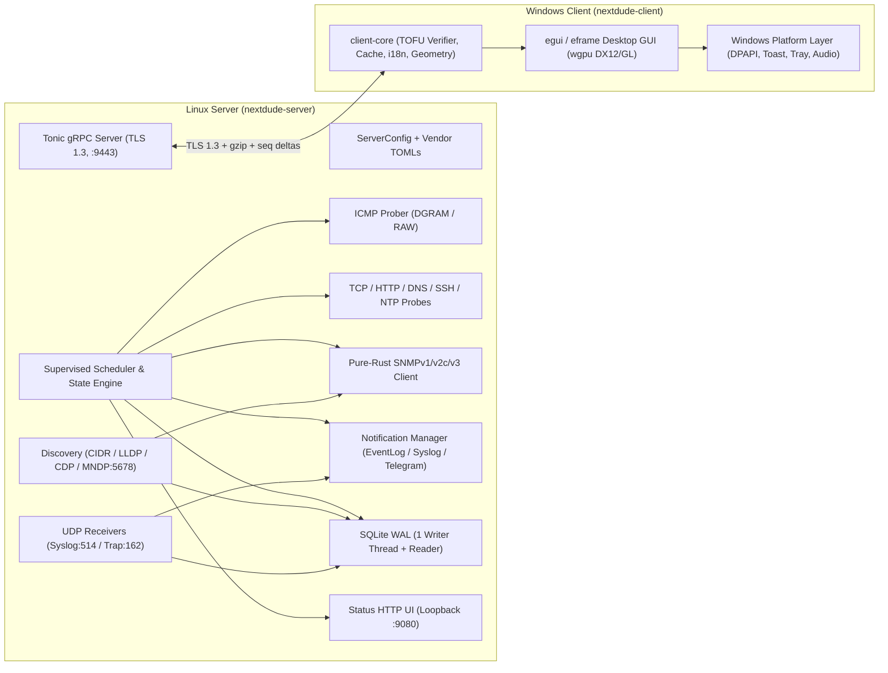

# NextDude Architecture

This document describes the module boundaries, concurrency model, protocol design, and data lifecycle across the four crates in the NextDude workspace.

---

## 1. High-Level System Topology

### Crate Boundaries

- **`crates/common` (`nextdude-common`)**: Pure cross-platform domain types, `APP_NAME` (`"NextDude"`), `APP_USER_MODEL_ID`, default ports (`9443`, `9080`, `514`, `162`, `5678`), validation rules, standard OID lookup dictionary, and generated `tonic`/`prost` types from `proto/nextdude.proto`. `#![forbid(unsafe_code)]`.
- **`crates/server` (`nextdude-server`)**: Headless Linux daemon binary & library. Depends on `nextdude-common`; never depends on client crates. `#![forbid(unsafe_code)]`.
- **`crates/client-core` (`nextdude-client-core`)**: Cross-platform client logic (`TofuVerifier`, `ClientStateCache`, background gRPC reconnect worker, `id`/`en` localization, themes, and elastic link path/hit-test math). `#![forbid(unsafe_code)]`.
- **`crates/client` (`nextdude-client`)**: Windows GUI frontend (`egui`/`eframe`, LOD topology canvas, panels, tray/toast/sound/DPAPI integration). `#![deny(unsafe_code)]` crate-wide with `#[allow(unsafe_code)]` scoped strictly to `src/platform.rs`, where every `unsafe` block carries an explicit `// SAFETY:` justification.

---

## 2. Server Subsystems

### 2.1 Storage & SQLite WAL (`crates/server/src/storage/`)

- **Single-Writer Model**: `StorageHandle::open` opens a dedicated read-write SQLite connection configured with `journal_mode=WAL`, `synchronous=NORMAL`, `foreign_keys=ON`, and `busy_timeout=10s`. A dedicated OS thread (`nextdude-sqlite-writer`) drains a bounded `sync_channel` (capacity 4096) in batches up to 64 tasks per wake-up so telemetry writes never starve UI RPC mutations or block Tokio worker threads.
- **Concurrent Reads**: Queries execute on a separate read-only connection inside `tokio::task::spawn_blocking`.
- **Migrations**: Versioned transactional migrations (`schema_migrations` v1..v3) covering admins/groups, preferences, images, maps, devices/services/probes/interfaces/links/networks/submaps/static items/dependencies, alert rules, maintenance windows, outages, syslog, SNMP traps, audit logs (`history_actions`), raw telemetry (`ts_raw`), rollups (`ts_1m`, `ts_5m`, `ts_1h`), and `server_runtime_settings`.
- **Retention & Rollups**: Periodically aggregates raw samples into `1m`, `5m`, and `1h` buckets and purges expired telemetry, events, syslog entries, and audit rows according to configurable retention windows (`retention_raw_hours`, `retention_rollup_days`, etc.).

### 2.2 Supervision, Scheduler & State Machine (`crates/server/src/engine/`)

- **Panic Isolation**: Background tasks (`polling_scheduler`, `rollup_retention`, `syslog_receiver`, `trap_receiver`, `mndp_listener`) run under `spawn_supervised`, wrapping futures in `AssertUnwindSafe(...).catch_unwind()`. Panics are caught, logged as `Critical` `system` events in SQLite, broadcast to connected clients, and restarted after a 2-second backoff.
- **Polling Hierarchy & Limits**:
  - Effective interval precedence: **Device override > Map override > Global setting** (`>= 5s`).
  - Jitter prevents thundering-herd probe bursts across 2,000+ nodes.
  - Bounded global concurrency (`max_concurrent_probes`, default 256) and per-device semaphore (`max_concurrent_per_host`, default 6).
  - Exponential backoff multiplies intervals for persistently down hosts.
- **Probe Debounce & Dependency Suppression**:
  - Per-probe debounce counters transition across `Unknown`, `Up`, `Down`, `Unreachable`, and `Partial`.
  - Acyclic dependency validation (`would_create_cycle`) rejects loops on save. When a parent device enters `Down`, descendant devices are computed via BFS (`compute_dependency_suppression`), marked `Unreachable`, excluded from redundant alert storms, and summarized on the root-cause notification with affected downstream counts.
- **Interface & Counter Math**:
  - Interfaces are keyed stably by `ifName` / `ifDescr` so router/switch reboots that renumber `ifIndex` automatically remap without losing link history.
  - Traffic bps uses 64-bit `ifHCInOctets`/`ifHCOutOctets` with 32-bit fallback (`ifInOctets`/`ifOutOctets`), handling counter rollover and reboot counter resets cleanly.

### 2.3 Pure-Rust SNMP Engine (`crates/server/src/snmp/`)

- **BER Codec (`ber.rs`)**: Encodes/decodes ASN.1 BER TLVs, OIDs, 32-bit and 64-bit integers/counters/gauges/timeticks, IPv4 addresses, opaque/strings, `GetRequest`, `GetNextRequest`, `GetBulkRequest`, `Response`, `TrapV1`, `TrapV2`, and `InformRequest`.
- **SNMPv3 USM (`usm.rs`)**:
  - RFC 3414 Appendix A.2.1 1 MiB password-to-key expansion and engine-ID localization.
  - Auth: `None`, `HMAC-MD5-96`, `HMAC-SHA1-96` (computed with authentication parameters zeroed before signing, constant-size 12-byte MAC field).
  - Privacy: `None`, `DES-CBC` (8-byte IV derived from boots + salt XOR pre-IV), and `AES-128-CFB` (16-byte IV derived from authoritative `engineBoots` || `engineTime` || 64-bit local salt).
- **Vendor Profiles (`profiles.rs`)**:
  - Loads `*.toml` from `system_profiles_dir` (`/usr/share/nextdude/profiles`) then `override_profiles_dir` (`/etc/nextdude/profiles`), merging by profile `id`.
  - Selects profile using longest `sysObjectID` prefix match and matches `sysDescr` against model rules for icon/device-type hints.

### 2.4 Probes (`crates/server/src/probe/`)

- `ProbeExecutor` trait abstracts local probe execution so remote/agent execution can be introduced later without altering the scheduler or gRPC layers.
- `IcmpProber` initializes IPv4 and IPv6 sockets at startup, preferring unprivileged `SOCK_DGRAM` (`IPPROTO_ICMP` / `IPPROTO_ICMPV6`) and falling back to `SOCK_RAW` if `CAP_NET_RAW` is available, reporting actionable remediation instructions when neither succeeds.
- Application probes execute asynchronously over Tokio without blocking OS threads (`TcpStream`, `hickory-resolver` DNS, `reqwest` HTTP/HTTPS, banner/protocol exchanges for FTP/SMTP/IMAP/POP3/SSH/Telnet, SNTP v4 client for NTP, and `SnmpClient`).

### 2.5 Security, Crypto & Image Sanitization

- **Key Management (`crypto.rs`)**: On first start, generates a 32-byte random `master.key` with mode `0600` (`ensure_strict_file_mode` refuses permissive modes on startup) and self-signs an ECDSA TLS certificate (`rcgen`) if custom PEM paths are omitted.
- **Image Assets (`images.rs`)**: Validates magic bytes (`PNG`, `JPEG`, `WEBP`, or `<svg>` XML). For SVG uploads, `roxmltree` strictly rejects `<script>`, `<foreignObject>`, external `http://`/`https://`/`javascript:`/`data:` hrefs, and `on*` event attributes, then pre-rasterizes PNG thumbnails (`32`, `64`, `128`, `256` px) via `resvg` so Windows clients only ever render vetted bitmaps.

### 2.6 Built-In Status Web Server (`crates/server/src/web_status.rs`)

- **Child Task Tracking (`ChildTaskTracker`)**: Tracks all supervised background tasks (`polling_scheduler`, `rollup_retention`, `syslog_receiver`, `trap_receiver`, `mndp_listener`, `status_web`) alongside RAII-guarded active worker counts (`active_probe_tasks`, `active_discovery_tasks`, `active_tool_tasks`) and poll scheduler timing.
- **Read-Only Telemetry Endpoints**: Serves an offline-capable HTML dashboard (`GET /`), JSON metrics snapshot (`GET /api/stats`, `/api/status`), and health endpoint (`GET /healthz`). Exposes strictly aggregate inventory counts, worker state, and Linux `/proc/self/status` + `/proc/loadavg` resource stats while redacting device identifiers, secrets, and admin details, enforced with `CSP`, `X-Frame-Options: DENY`, `X-Content-Type-Options: nosniff`, bounded header reads, and a 32-connection semaphore.

---

## 3. Protocol & Client State Synchronization

### 3.1 gRPC API (`crates/common/proto/nextdude.proto`)

- Transport: HTTP/2 + gRPC over TLS 1.3 (`tonic` with `gzip` compression, 32 MiB max message size, HTTP/2 keepalive).
- Authentication: `Login` verifies protocol version compatibility (`API_VERSION = 1`), enforces brute-force lockout counters, verifies Argon2id password hash, and returns a bearer session token used in `authorization` gRPC metadata.
- Streaming (`Subscribe`):
  - Initial `FullSnapshot` delivers current maps, entities, interfaces, charts, rules, windows, and server settings.
  - Ongoing `StreamEvent` frames push strictly monotonic `seq` values (live ~1 Hz metric batches, entity deltas, syslog/trap batches, events, alerts, outages, discovery progress, and heartbeats).
  - If a client observes a sequence gap (`ev.seq != last_seq + 1`) or receives `ResyncRequired` after server broadcast lag, `ClientStateCache` automatically triggers a clean `UpdateSubscription` resynchronization.
- Per-session Undo/Redo stack (`api/mod.rs`) records reversible map and entity operations on the server.

### 3.2 Windows Client Architecture (`crates/client-core/` & `crates/client/`)

- **Single Instance & Lifecycle (`platform.rs`, `main.rs`)**:
  - Enforces a single instance per user session via Win32 `CreateMutexW`.
  - Sets `SetCurrentProcessExplicitAppUserModelID("NextDude.Client.Desktop.1")` to match the Start Menu shortcut created by WiX v4 for Windows Action Center Toasts.
  - Attempts DX12 / OpenGL `wgpu` initialization and falls back cleanly to a software `wgpu` adapter when hardware GPU drivers are unavailable (e.g., headless VMs / RDP sessions).
- **Canvas & Geometry (`map_canvas.rs`, `geometry.rs`)**:
  - World-to-screen camera transform with viewport culling.
  - LOD tiers simplify link labels, metrics, and node chrome smoothly as zoom scales out so panning and dragging 2,000 nodes stay responsive while idle repaints consume minimal CPU.
  - Parallel links connecting the same node pair receive symmetric perpendicular offsets (`parallel_link_offset`) and support straight, quadratic Bezier (`bend_offset`), and rounded orthogonal routing (`compute_elastic_link_path`).
